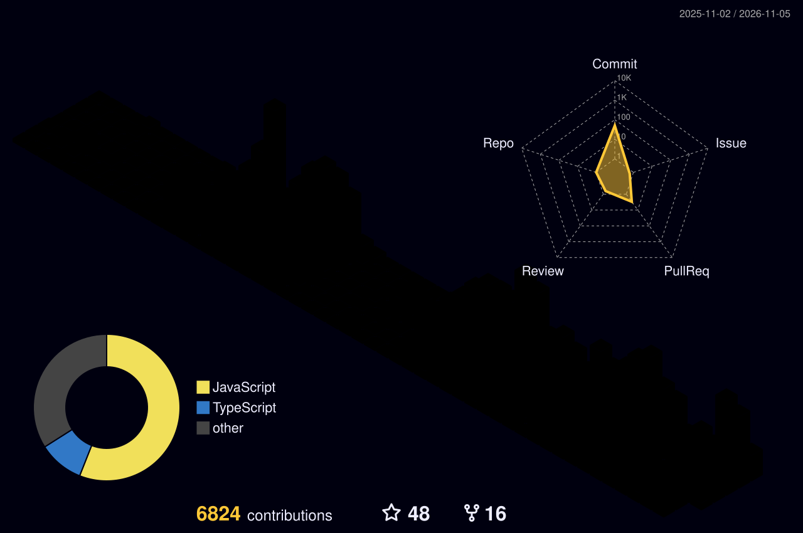

<h1 align="center">Hi, I'm Dave 👋</h1>

Building <a href="https://smuk.ai">SMUK AI</a> · <a href="https://serf.land">Serf Land</a> · <a href="https://site.rehab">Site Rehab</a>

<!-- Contribution snake — regenerated daily by .github/workflows/snake.yml -->

  <picture>
    <source media="(prefers-color-scheme: dark)" srcset="https://raw.githubusercontent.com/zafrani/zafrani/main/snake/github-snake-dark.svg" />
    <source media="(prefers-color-scheme: light)" srcset="https://raw.githubusercontent.com/zafrani/zafrani/main/snake/github-snake.svg" />
    
  </picture>

<!-- 3D contribution calendar — .github/workflows/profile-3d.yml. Other variants in profile-3d-contrib/: green, season, night-view, night-green, gitblock -->

  <picture>
    <source media="(prefers-color-scheme: dark)" srcset="https://raw.githubusercontent.com/zafrani/zafrani/main/profile-3d-contrib/profile-night-rainbow.svg" />
    <source media="(prefers-color-scheme: light)" srcset="https://raw.githubusercontent.com/zafrani/zafrani/main/profile-3d-contrib/profile-green-animate.svg" />
    
  </picture>

<!-- Tamagotchi (hunger = commit streak) next to stats + streak -->
<table align="center">
  <tr>
    <td align="center" valign="middle">
      <picture>
        <source media="(prefers-color-scheme: dark)" srcset="https://raw.githubusercontent.com/zafrani/zafrani/main/tamagotchi/assets/tama-dark.svg" />
        <source media="(prefers-color-scheme: light)" srcset="https://raw.githubusercontent.com/zafrani/zafrani/main/tamagotchi/assets/tama-light.svg" />
        
      </picture>
    </td>
    <td align="center" valign="middle">
       
      
    </td>
  </tr>
</table>

<!-- lowlighter/metrics — .github/workflows/metrics.yml (needs the PROFILE_PAT secret) -->

  

